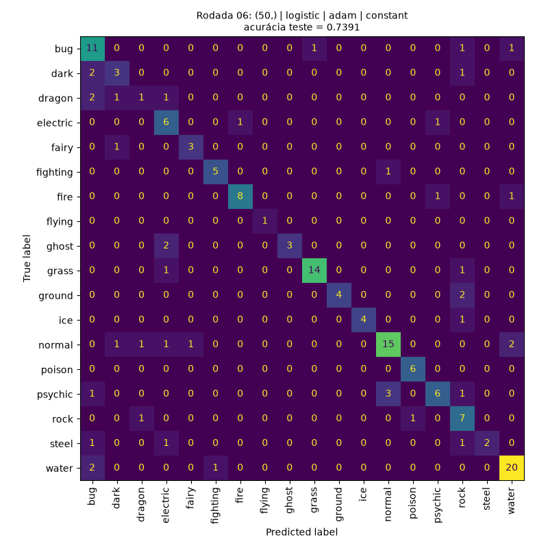

# 🧠 PokeLearn

**A neural network (scikit-learn MLP) that predicts a Pokémon's primary type from its stats and attributes, plus a systematic study of how architecture, activation function, training length and learning rate affect its accuracy.**

Given attributes such as base stats, height, weight, abilities and secondary type, the model classifies each Pokémon into one of **18 primary types**. The project runs **38 controlled experiments** and compares them using accuracy, convergence behavior and confusion matrices.

**Best result: 73.9% test accuracy** on 18 classes (a random guess would score about 5.6%, and always predicting the most common type about 14.2%).

> Built as a Machine Learning coursework project at FATEC Votorantim.

<p align="center">
  
  <br/>
  <em>Confusion matrix of the best run: one hidden layer of 50 neurons, sigmoid activation.</em>
</p>

---

## 📊 Key Findings

All numbers below come from `resultados/resultados.csv`.

| Question | Result |
| --- | --- |
| **Best configuration** | 1 hidden layer, 50 neurons, sigmoid (`logistic`), `adam`: **73.9%** test accuracy, stopped by itself after 936 epochs |
| **Single vs. two hidden layers** | Single layer was better: **72.9%** average vs **68.4%** for two layers |
| **ReLU vs. sigmoid** | Practically tied: **71.0%** (ReLU) vs **71.4%** (sigmoid) on average |
| **Solver** | `adam` averaged **71.2%**, while `sgd` averaged **66.2%** |
| **Constant vs. adaptive learning rate** (with `sgd`) | No meaningful difference: **66.2%** vs **66.2%** on average |
| **Training length** | With 50 epochs the model reaches only 34.2%; 500 epochs gets 73.3%; from 1000 on, training stops on its own after 936 epochs because the loss stops improving |

**Observations and limitations**

- **Overfitting:** training accuracy reaches about 100% in almost every run while test accuracy stays around 70%, so the models memorize the small training set (640 instances) instead of generalizing.
- **Small test set:** with 161 test instances, one extra correct prediction moves accuracy by about 0.6 percentage points, so differences of one or two points between runs are within noise. Each configuration was run once, with a fixed seed and a single train/test split.

---

## 🔬 Dataset and Preprocessing

**Dataset:** [The Complete Pokemon Dataset (Kaggle)](https://www.kaggle.com/datasets/rounakbanik/pokemon), included in the repository as `pokemon.csv`.

- **Size:** 801 instances, 41 columns
- **Target (y):** `type1`, with 18 classes
- **Numeric features (16):** scaled with `StandardScaler`
- **Categorical feature:** `type2`, encoded with `OneHotEncoder`
- **Multi-valued feature:** `abilities` holds a list of abilities per Pokémon, so it is encoded with `MultiLabelBinarizer` (one 0/1 column per ability)
- **Split:** 80% train / 20% test with a **stratified** `train_test_split`, so every type keeps its proportion in both sets

**Avoiding data leakage:** the dataset includes `against_*` columns (damage multipliers against each type), which almost give away the Pokémon's own type. They are **excluded by default** (`USAR_AGAINST = False`) so the model has to learn from the Pokémon's actual attributes. They can be enabled in the configuration.

---

## 🧪 Experiments

The script runs 38 `MLPClassifier` trainings, and each one prints its parameters, epochs run, stop reason, train and test accuracy, and confusion matrix.

| Group | What varies |
| --- | --- |
| **Architecture** | One hidden layer with 10, 20, 50, 100 or 200 neurons; two layers with 10+10, 20+20 or 50+50 |
| **Activation** | `relu` vs `logistic` (sigmoid) across all architectures, with the `adam` solver |
| **Epochs** | `max_iter` from 50 to 2000 on the best configuration, showing when training stops by itself after 10 epochs without improvement |
| **Learning rate** | `constant` vs `adaptive` across all architectures, using `sgd` since `learning_rate` has no effect on `adam` |
| **Evaluation** | A confusion matrix for every run |

Outputs are saved in `resultados/`:

- `cm_rodada_XX.png`: confusion matrix of each run
- `resultados.csv`: parameters, epochs and accuracies of all runs

---

## 🧰 Tech Stack

| Category | Technologies |
| --- | --- |
| **Language** | Python 3.11+ |
| **Machine Learning** | scikit-learn (`MLPClassifier`, `StandardScaler`, `OneHotEncoder`, `MultiLabelBinarizer`) |
| **Data** | pandas, NumPy |
| **Visualization** | Matplotlib |
| **Environment** | Jupyter Notebook, virtual environment (`venv`), pinned `requirements.txt` |

---

## 📁 Project Structure

| File | Description |
| --- | --- |
| `learnPokemon.py` | Python script version |
| `learnPokemon.ipynb` | Same logic as a Jupyter Notebook, split into cells |
| `resultados/` | Confusion matrices (PNG) and `resultados.csv` from the last run |
| `pokemon.csv` | Dataset |
| `atividade.txt` | Original assignment statement |
| `requirements.txt` | Pinned dependencies |

---

## ⚙️ Running Locally

**Prerequisite:** Python 3.11 or higher (tested with 3.12).

### 1. Create and activate a virtual environment

**Linux / macOS / WSL**
```bash
python3 -m venv .venv
source .venv/bin/activate
```

**Windows (PowerShell)**
```powershell
python -m venv .venv
.venv\Scripts\Activate.ps1
```

### 2. Install the dependencies

```bash
pip install --upgrade pip
pip install -r requirements.txt
```

### 3a. Run the script

```bash
python learnPokemon.py
```

The full run takes about 5 minutes. It doesn't open any windows: confusion matrices are printed in the terminal and saved to `resultados/`. To keep the terminal output as well:

```bash
python learnPokemon.py | tee resultados/saida_terminal.txt
```

### 3b. Or run the notebook

Jupyter is not part of `requirements.txt`, so install it in the same environment:

```bash
pip install notebook
jupyter notebook learnPokemon.ipynb
```

Then run the cells in order (about 8 minutes). Each confusion matrix also appears right below its run.

---

## 🎛️ Configuration

Set at the top of the script and in the first cell of the notebook:

| Variable | Default | Description |
| --- | --- | --- |
| `USAR_AGAINST` | `False` | Includes the `against_*` columns, which almost reveal the type |
| `MAX_ITER` | `2000` | Maximum epochs, set high so training stops by lack of improvement |
| `N_ITER_NO_CHANGE` | `10` | Epochs without improvement before training stops |
| `LR_INIT_SGD` | `0.1` | Initial learning rate for `sgd` (with the default 0.001 the network barely learns) |
| `ARQUITETURAS` | 8 architectures | Hidden-layer configurations tested |
| `ATIVACOES` | `relu`, `logistic` | Activation functions tested |
| `SEED` | `42` | Random seed for reproducible results |

---

## 👤 Author

**Guilherme Nobrega**
Full Stack developer and Software Development (Multiplatform) student at FATEC Votorantim, Brazil.

[](https://www.linkedin.com/in/guilherme-nobrega-0a5104104/)
[](https://github.com/guilermes)
